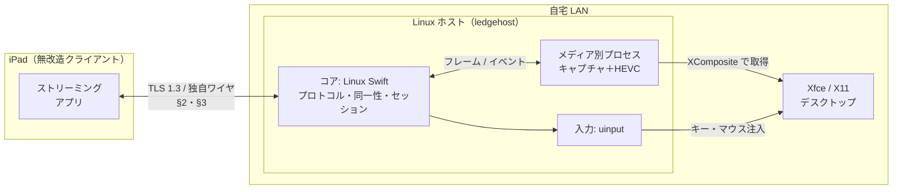
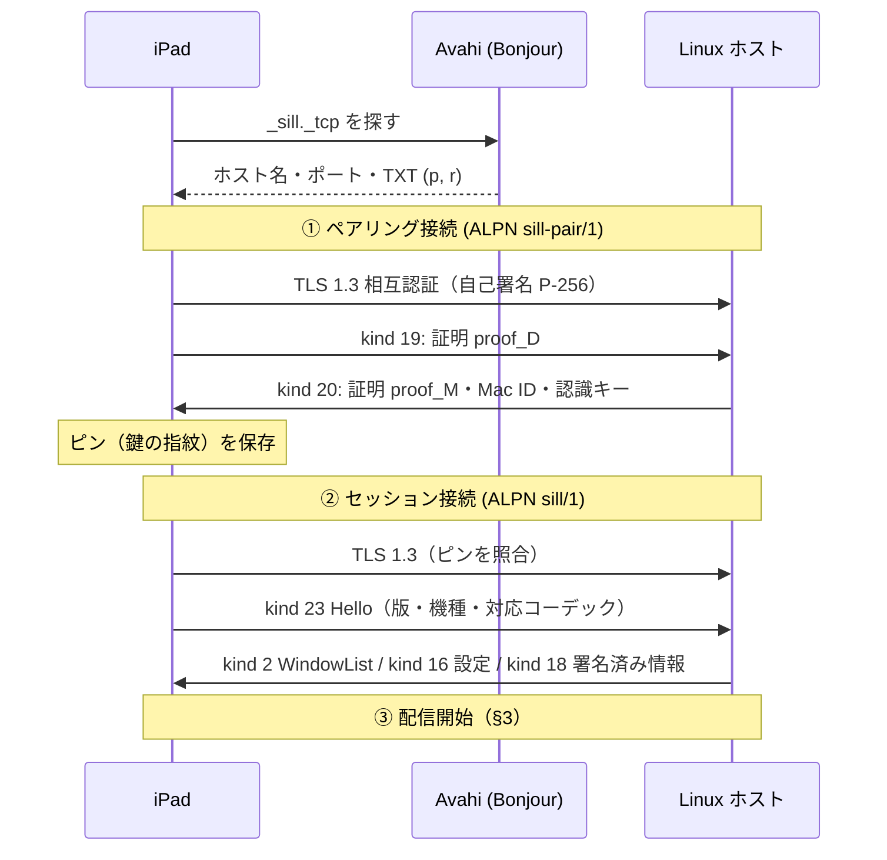
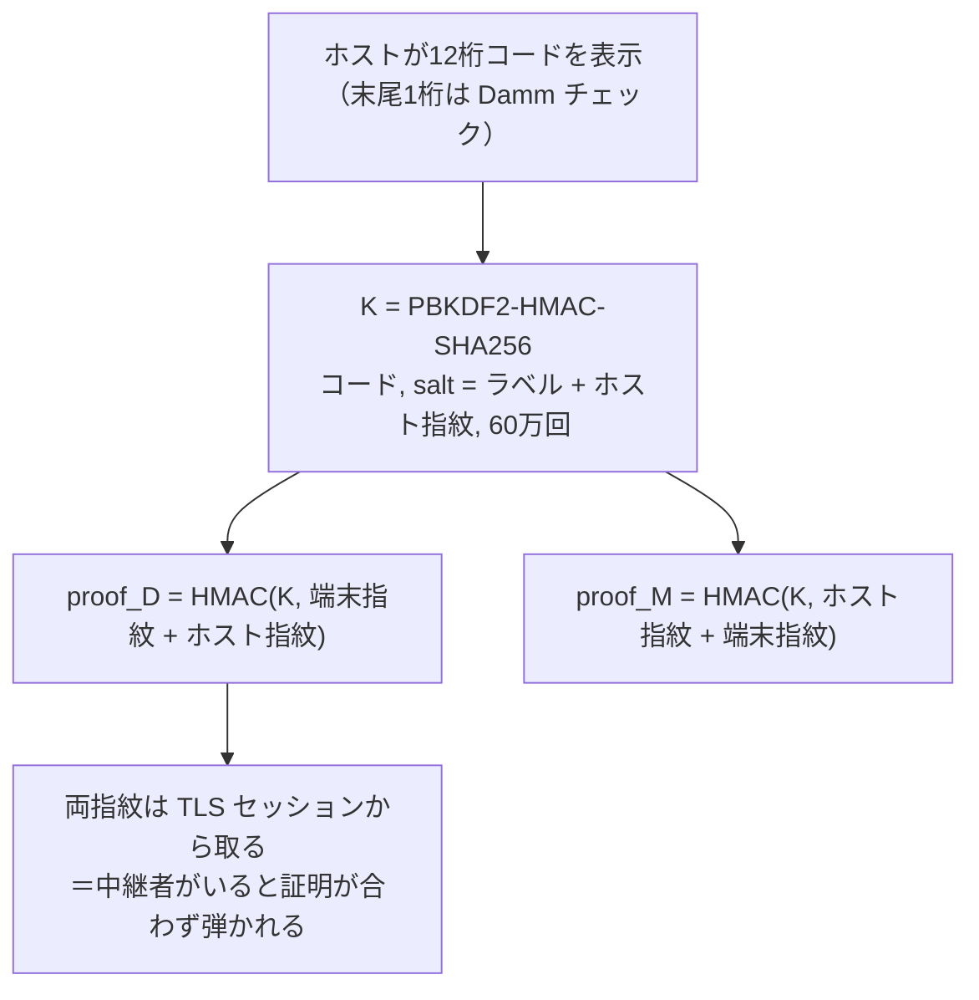
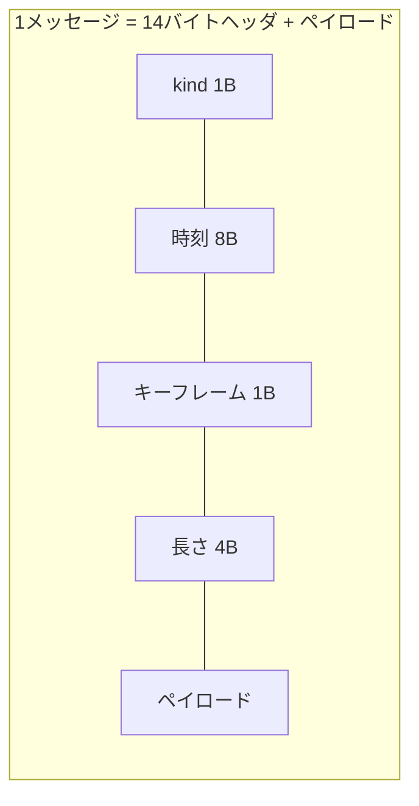
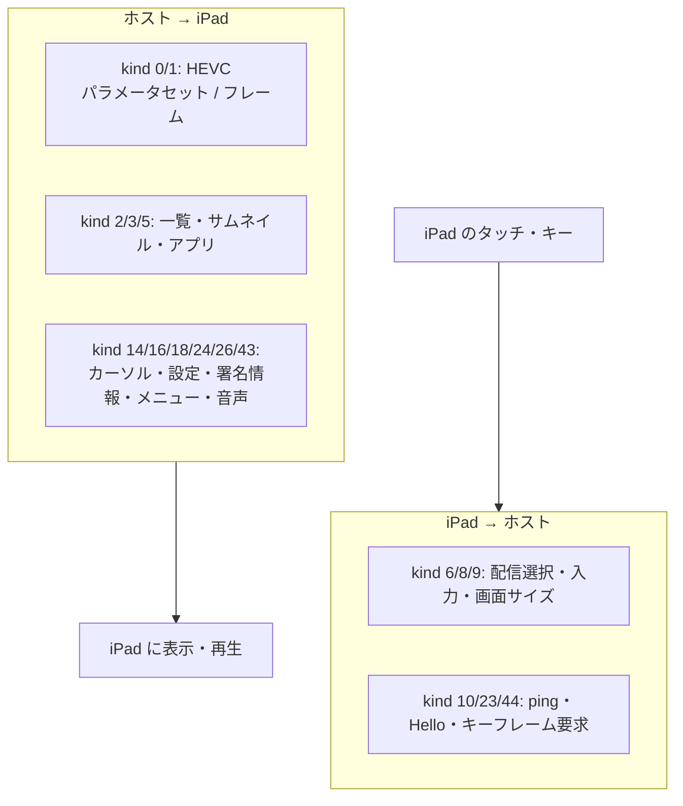
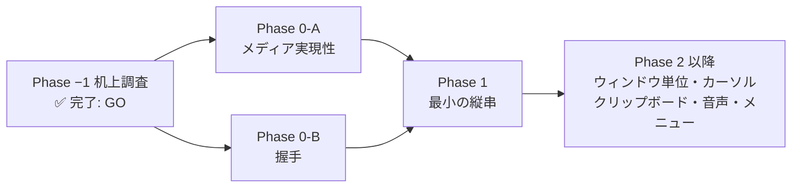
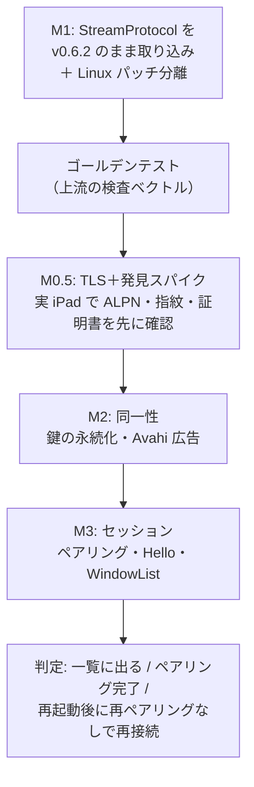

# ledgehost 図解 — 設計・接続・通信・開発手順

無改造の iPad クライアント（App Store 版 0.6.2）から、Linux デスクトップに
接続できるようにするホストの解説。仕様の基準は上流タグ v0.6.2
（詳細は `phase-minus-1-report.md`）。

## 1. 全体設計

要点: **正しさが要るプロトコル部分は Swift で上流とバイト一致させ、落ちると困るメディア部分は別プロセスに隔離する。**

部品の対応（Mac の部品 → Linux の対応物）

| Mac 側 | Linux 側 | 備考 |
|---|---|---|
| StreamProtocol（ワイヤ形式） | Linux Swift で流用 | 21ファイル中17が無変更でコンパイル可（Phase −1 実測） |
| CryptoKit / Security | swift-crypto | HMAC・SHA256・P-256 が API 互換 |
| Network.framework の TLS | SwiftNIO + NIOSSL | TLS の作り手だけ差し替え、ワイヤは不変 |
| Bonjour | Avahi | サービス種別 `_sill._tcp` |
| ScreenCaptureKit（ウィンドウ単位） | XComposite | 最小化したウィンドウは描画されない罠あり |
| VideoToolbox HEVC | VA-API（GStreamer `va`） | Annex B → 長さ前置き形式へ詰め替え |
| Accessibility（入力注入） | uinput | 高解像度スクロール・筆圧まで扱える |
| 仮想ディスプレイ（私的 API） | xrandr 論理モニタ仮説 | 対応物なし。Phase 0-A で検証、駄目なら実画面方式 |

## 2. 接続の仕組み（発見 → ペアリング → セッション）

要点: **信頼は「鍵の指紋（SPKI の SHA-256）」だけ。証明書の名前・期限・発行者は見ない。だから自己署名で Linux でも成立する。**

ペアリングの暗号（12桁コード方式）

- ペアリング後は再接続のたびにピンを照合するので、ホスト再起動後も
  再ペアリング不要（＝鍵と ID をファイルに永続化することが Phase 0 の合格条件）。
- Bonjour TXT の `p` はドアの方式（平文 / TLS・ペアリング必須 / TLS・開放）、
  `r` は保存済みホストを見分ける認識タグ（認証ではない）。
- App Attest・DeviceCheck・iCloud 鍵・アカウントは一切なし（Phase −1 で全数確認）。

## 3. 通信の仕組み（ワイヤ形式と中身）

要点: **種類は kind 番号、互換性は「知らない kind は読み飛ばす」「JSON の項目追加は任意」が大原則。**

上限と映像の決まり

| 方向 | 上限 | 超えたら |
|---|---|---|
| フレーム (kind 1) | 32 MiB | 切断 |
| その他のホスト→端末 | 4 MiB | 切断 |
| 端末→ホスト | 1 MiB | 切断 |
| ペアリング (kind 19) | 4096 B / 10秒以内 | 拒否 |

- 映像: ウィンドウ単位キャプチャ → HEVC（Bフレームなし、Main 8bit）。
  遅れたフレームは溜めずに落とす。キーフレームは端末が kind 44 で要求。
- 入力: 日本語などは端末側で確定した文字列が届く（typed text）。
  ジェスチャは名前で届き、ホスト側でショートカットに変換。
- 音声: Hello で端末が対応コーデック（aac-eld）を提示したときだけ kind 43。

## 4. 開発の手順（フェーズと合格条件）

要点: **一番危ない2つ（映像が速さに足りるか／握手が本物と合うか）を、独立に先に潰す。**

Phase 0-B の中身（M0.5 を追加 — レビュー反映）

- 取り込みは「原典をそのまま1コミット → Linux 変更は別コミット（パッチ列）」。
  上流タグ更新が機械作業になるようにする（レビューの必須変更1）。
- TLS は「ハンドシェイクでは P-256 だけ通し、完了後に ALPN と指紋で門番」
  （NIOSSL の検証コールバックに ALPN が渡らないため。レビューの必須変更6）。
- 参照クライアント（Linux 上のヘッドレス版）を先に作り、実機確認は節目だけにする。

Phase 0-A の中身

- `vainfo` で HEVC 低電力エンコード（EncSliceLP）と RC モード、ドライバと
  HuC ファームウェアを確認 → 実エンコードして iPad で再生できるか確認。
- 判定: 対象解像度（2266×1488）で 60fps / エンコード遅延 10ms 未満 / CPU 50% 未満。
- xrandr の論理モニタ実験は、自動復帰スクリプトと設定バックアップ付き、
  利用者の立会いでだけ実施。

## 5. 進め方の約束

- 設計の実質判断は実装前に レビューを通す（ドラフト → レビュー → 実装）。
- ワイヤの振る舞いは必ず上流ソースのファイル・行を出典にして実装する。推測で作らない。
- 公開物に個人を特定する文字列を入れない。コミットは GitHub の noreply
  アドレス、push 前に禁止文字列チェックを通す。repo は当面 private。
