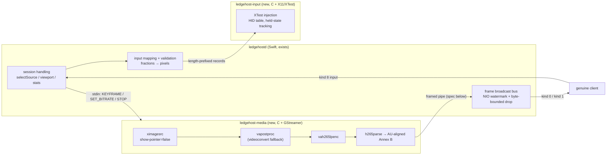

# Phase 1 plan — the minimal streaming slice (v2)

Status: v2, approved by the user 2026-11-26. Implementation
starts with P1-M0. This version folds in the required changes
from three independent reviews of the v1 draft (an Opus advisor
review and two coding-model reviews, all "proceed with changes";
review files: docs/phase-1-review-opus.md,
docs/phase-1-review-swe2.md, docs/phase-1-review-fable.md).

Goal: from the genuine client, see the host's desktop moving and
operate it — capture → HEVC → wire → client decode, plus pointer,
scroll and keys back. One source (the desktop), one resolution
(the display's own), LAN only. Everything else (audio, windows as
separate sources, virtual displays, remote access) is a later
phase.

## What Phase 0 established

- The protocol core (identity, pairing, TLS gate, catalog) is
  accepted by the genuine client 0.6.2 on the target machine.
- The target's VA HEVC low-power encoder does 2266x1488 with
  ~90 fps headroom, zero reordering; a test encode plays on the
  iPad. ximagesrc moves full-resolution frames at negligible CPU.
- Correction to the Phase 0 record: the ~25 fps seen in 0-A was
  the unconstrained-caps fixation default, not a display cap —
  with explicit framerate=60/1 caps the same display sustains
  ≥60 buffers/s. The seat display's real capture rate is still
  unmeasured; that is gate P1-M0 below.
- The client sends, per session: selectSource (kind 6), viewport
  (kind 9, with wanted fps), input (kind 8), clientStats
  (kind 12, 1 Hz), keyframeRequest (kind 44).

## The wire contract for media and settings (upstream sources)

- kind 0 parameterSets: `ParameterSets.encoded()` — nalLen(1),
  count(1), then per set length(2, BE) + bytes. nalLen is 4.
  Sent before the frames it describes, and again whenever the
  sets change. Marked isKeyframe in the header. A session must
  never be resumed on a keyframe whose sets it has not received
  (see backpressure).
- kind 1 frame: one HEVC access unit, NALs length-prefixed
  (hvcC style, 4-byte lengths), parameter-set NALs NOT in the AU
  (they live in kind 0). Header carries the capture timestamp
  (seconds) and the isKeyframe flag. Frame payload cap is
  `maxFramePayload` (32 MiB, StreamMessage.swift:123).
- StreamSource is `.desktop` for this phase. Subscription state
  is per session: `.desktop` subscribes, `.none` unsubscribes
  (the host stops sending video to that session and re-sends the
  WindowList with `active: .none`), `.window(id)` is logged and
  ignored with the list's `active` re-asserted (this host lists
  no windows). When a session's selectSource changes, the host
  re-sends the WindowList (kind 2) with `active` updated.
- InputEvent positions are fractions of the video frame; the
  host maps them onto the source rectangle (decision 6). Cases:
  pointer (move/leftDown/leftUp/rightDown/rightUp), scroll,
  text, scrollGesture, key (USB HID usage + down + modifiers
  bitmask at CGEventFlags positions: shift 1<<17, control
  1<<18, alt/option 1<<19, command 1<<20 — Input.swift:33-34).
  The text cases `"\n"`, `"\t"`, `"\u{8}"` are delivered as the
  matching keys, not typed as characters (Input.swift:22-24).
- ClientStats (kind 12) reports the client's received fps,
  frameAgeMs (host encode timestamp → device receipt) and RTT —
  the phase's latency evidence, logged by the daemon at 1 Hz.
- keyframeRequest (kind 44): the host honours at most one per
  second per connection (StreamMessage.swift:87-93). The
  client's own recovery resends only after ~4 s without a
  keyframe, so drop recovery must not wait for it (decision 4).
- Viewport (kind 9) must pass `ViewportBounds.refusal`
  (Viewport.swift:32-37 — upstream lost a host to unvalidated
  doubles reaching an Int conversion). `wantedFPS` clamps to
  24…maxFPS; nil means 60. Running fps is the max across
  sessions.
- changeSettings (HostSettings): every decodable change is
  answered to that device alone with a kind 16 whose
  `answering` equals the change's `token`
  (HostSettings.swift:239-242). Values are whitelisted against
  `SettingsChoices`: maxFPS {60,120}, bitrate the quality
  presets {4M, 8M, 15M, 25M, 40M}, captureScale {1,2}
  (HostSettings.swift:297-311). Fields this host does not
  implement keep their advertised values in the answer — a
  silent drop reads as a refusal the client cannot explain
  (HostSettings.swift:26-28). `stream` (RunningStream) is
  populated once the pipeline runs. `persistent` stays false
  until changes are actually persisted.
- `StreamSettings.bitrate` is per 60 fps: the encoder target
  is `bitrate × runningFps / 60` (HostSettings.swift:67-68).
  The catalog therefore advertises a preset value, 15 Mbps
  (the v1 draft's 12 Mbps is a non-preset "Custom" the client
  can only display read-only).

## Architecture

Both helper pipes are carried on the daemon's event loop via
NIO pipe channels — no blocking read or write anywhere on the
loop — and the daemon ignores SIGPIPE (a dead helper must never
kill the daemon). Session channels get a WriteBufferWaterMark;
the drop decision reads `isWritable` / writability changes, not
a daemon-side queue in front of NIO's unbounded outbound buffer.

## Decisions (v2)

1. Media is a separate C process, per the Phase −1 architecture
   (core in Swift, media out-of-process). The daemon spawns it
   by absolute path with a minimal, sanitised environment
   (DISPLAY, XAUTHORITY, an explicit GStreamer environment with
   GST_DEBUG and GST_PLUGIN_* unset), reads framed records from
   its stdout, and controls it over stdin (KEYFRAME,
   SET_BITRATE, STOP). AU alignment is solved by h265parse
   inside the helper (stream-format=byte-stream, alignment=au);
   the daemon scans start codes only within one AU buffer,
   never across a raw byte stream. A gst-launch child was
   rejected: it cannot force a keyframe on demand.
2. The Annex B → wire conversion (strip VPS/SPS/PPS into
   kind 0, 4-byte length-prefix the rest; strip AUD and filler
   NALs) lives in the daemon, unit-tested against recorded
   encoder output. The daemon seeds its kind 0 cache from the
   helper's sets record and re-sends kind 0 whenever the sets
   change byte-wise, and before any IDR a session resumes on.
3. One pipeline, broadcast to every session watching the
   desktop (upstream's model). A session that selects the
   desktop gets the cached parameter sets at once and a forced
   keyframe. Pipeline lifecycle: start on the first subscriber;
   stop 5 s after the last watcher leaves (the client opens a
   short-lived session at connect that is immediately replaced;
   the debounce prevents start/stop flapping). Helpers
   self-terminate on stdin EOF or stdout EPIPE and are spawned
   with PR_SET_PDEATHSIG; the daemon reaps children, restarts a
   dead media helper with backoff, and after repeated failures
   sends kind 22 goodbye (reconnect: true, with a human
   message) instead of leaving a frozen picture.
4. Backpressure is byte-accounted per session on the NIO
   channel: high-water mark = max(4 MiB, 2× the IDR size
   measured in P1-M1). A session over the mark drops access
   units until it resumes; on entering the dropping state the
   daemon forces an IDR (coalesced, see below), and on resume
   it enqueues kind 0 (current sets) then the IDR, atomically.
   Kind 0 is never dropped. Enter/leave-dropping is logged per
   session with counts so P1-M4 can show convergence.
   Keyframe discipline: forced IDRs are coalesced globally
   (≥250 ms apart) and kind 44 is honoured at most once per
   second per connection.
5. The cursor stays OUT of the video (upstream's model: the
   client draws its own pointer). This requires the explicit
   ximagesrc property `show-pointer=false` (its default is
   true). kind 26 (host pointer position) is not in this
   phase; the trade-off is that a pointer moved by someone at
   the host is invisible on the device. As a cheap probe, the
   daemon sends one static default cursorShape (kind 14) on
   selectSource — whether the client draws a usable pointer
   with only that is observed in P1-M3.
6. The source rectangle is defined once — the primary RandR
   output's CRTC rectangle (the root window when single-head) —
   and shared by capture and input mapping:
   `x_px = rect.x + clamp(x,0,1) × (rect.w − 1)`. A RandR
   change (resolution or layout) restarts the pipeline with
   fresh parameter sets. The daemon never opens an X connection
   itself; DISPLAY/XAUTHORITY from its environment are passed
   only to the helpers. No display number is hardcoded.
7. Frame timestamps are the capture wall-clock (seconds, the
   same epoch the header already uses), stamped by the helper
   from the buffer PTS plus its start wall-clock, re-anchored
   periodically so NTP slew cannot drift it. This deliberately
   makes frameAgeMs include capture+convert+encode; the helper
   logs its own capture→AU-out latency once per second so the
   budget can be decomposed. The host must be NTP-synced
   (checked in P1-M4) or frameAge is meaningless.
8. Keyboard input uses a real table: USB HID usage → Linux
   KEY_* code (the kernel hid-input.c `hid_keyboard[]` table),
   then X keycode = KEY_* + 8. (v1's "usage + 8" was wrong:
   HID 0x04 'a' is KEY_A 30 → X keycode 38, not 12.) The table
   covers letters, digits, Return/Escape/Backspace/Tab, the
   nav cluster, F-keys, keypad, and modifier usages
   0xE0–0xE7, and is unit-tested without X. The `modifiers`
   bitmask is applied by the daemon: it diffs the bitmask per
   event and emits explicit modifier press/release key ops
   around the key op (command → Super). Text typing uses a
   fast path — look the character's keysym up in the current
   keymap (with shift level) and only use the temporary-remap
   trick for characters absent from the layout; the scratch
   keycode is reset to NoSymbol on helper startup and exit
   (a crash mid-remap must not leave the server keymap altered).
9. Held input is tracked per session (keys, buttons,
   modifiers). On session end, helper restart, or daemon
   shutdown, everything that session held is released. A stuck
   key on the real desktop — with X autorepeat running it —
   is the failure this prevents.
10. Input is validated before it reaches XTest, and the helper
    re-validates (defence in depth): fractions clamped to
    [0,1]; scroll deltas bounded and accumulated so sub-click
    fractions are not lost; pointer moves coalesced to the
    latest; text capped at 4096 characters per event; at most
    240 input events per second per session; unknown HID
    usages dropped; keycodes checked against the server's
    min/max. Only a session that has selected the desktop may
    inject.
11. Encoder configuration is explicit: `b-frames=0`,
    `key-int-max=300` (a 5 s safety net at 60 fps — recovery
    is by forced IDR, not by GOP; a 1 s GOP would put an
    IDR-sized spike on the wire every second),
    `rate-control=cbr` with a small VBV (cpb-size ≈ 2 frames
    of bits; property units verified in P1-M1), and a
    `queue leaky=downstream max-size-buffers=1` before the
    encoder so a lagging encoder drops raw frames, never
    encoded AUs. The helper raises its stdout pipe buffer
    (≈1 MiB) so an IDR is not dozens of read wakeups. The
    broadcast fan-out builds each kind 0/1 message once as a
    ByteBuffer and writes the same buffer to every session.
12. Live retune semantics: bitrate is a property write if the
    encoder accepts it in PLAYING (verified in P1-M5), else a
    pipeline restart; fps changes are caps renegotiations and
    always restart the pipeline (upstream's own rule,
    Viewport.swift:20-22), resuming via the standard rejoin
    path (cached sets + forced IDR).

## IPC specifications

Media helper → daemon (stdout; framed records, nothing else may
ever reach stdout — all logging is stderr):

- Header: magic "LHM1" (4), version (1) = 1, tag (1):
  1 = access unit, 2 = parameter sets; flags (1): bit 0 =
  keyframe; reserved (1); capture timestamp (8, Double,
  wall-clock seconds); payload length (4, BE) ≤ 32 MiB.
- A sets record's payload is the VPS/SPS/PPS as Annex B,
  concatenated. An AU record's payload is one Annex B access
  unit, parameter sets included if the encoder emitted them
  (the daemon's converter separates them).
- The daemon validates magic, version, tag, length and a sane
  timestamp (within 24 h of now); any violation kills and
  restarts the helper rather than allocating on faith.

Daemon → input helper (stdin; length-prefixed binary records —
a line protocol cannot carry typed text, which legitimately
contains "\n"):

- Record: length (4, BE, ≤ 64 KiB) + body. Body: op (1) +
  fields. Ops: 1 pointer (kind (1), x (4), y (4) — fractions
  ×1e6, clamped), 2 scroll (dx (4), dy (4) — ×1e6), 3 key
  (HID usage (2, BE), down (1)), 4 text (UTF-8 bytes, the
  record length bounds it), 5 release-all (the session ended;
  release everything it held), 6 reset (drop all state).
  Modifier application arrives as ordinary op-3 records for
  usages 0xE0–0xE7, sequenced by the daemon.
- The helper rejects unknown ops and out-of-range fields, and
  tracks held state per the single input stream (the daemon
  serialises sessions; arbitration is the daemon's: only the
  session that most recently selected the desktop injects —
  refined if real use shows a conflict).

## Milestones

- P1-M0 Capture gate (measurement, before integration).
  On the target desktop session (see the progress log: the
  target machine is headless, its :0 is a lightdm greeter with
  no user session, and the user designated the :21 remote
  desktop session, 1600x1200, as the desktop this phase
  mirrors), run both candidate pipelines at that session's
  native resolution with framerate=60/1 for 10 s each —
  (a) ximagesrc use-damage=false show-pointer=false →
  vapostproc → NV12 (VAMemory) → vah265lpenc → fakesink
  sync=false, (b) the same with videoconvert in place of
  vapostproc — and record sustained fps and CPU, once on an
  idle desktop and once with a busy desktop (scrolling
  content). Record the numbers in this document's progress
  log. A total capture failure stops the phase here; a lower
  rate adjusts the fps targets, it does not block the slice.
- P1-M1 Converter + proof offline. The Annex B → wire
  converter with unit tests; the keymap table with unit tests;
  the probe gains a "record" mode that saves a session's
  kind 0/1 payloads (with header flags and timestamps),
  reassembles them, and the result must decode cleanly in
  ffprobe with the expected frame count. Fixtures come from a
  synthetic source (videotestsrc through the real helper
  pipeline) — never recordings of a real desktop — and are
  committed under Tests/. In this milestone also verify:
  GstForceKeyUnit on the running pipeline produces a real IDR
  (check the NAL types of the next AU), the IDR size at the
  catalog settings (feeds decision 4's high-water mark), and
  coded vs display width (the conformance crop) in ffprobe.
- P1-M2 Media helper + daemon integration. selectSource
  (.desktop) starts the pipeline; parameter sets and frames
  flow; keyframe-on-join and kind 44 are honoured here (not
  deferred). Acceptance (real client): the desktop is visible
  and visibly moving (a clock's seconds, a window dragged at
  the host).
- P1-M3 Input helper. First, log raw kind 8 without injecting
  and record what the genuine client actually sends (the
  .key/.text split with keyRepeat unset, whether modifiers
  arrive as their own key events, as the bitmask, or both) —
  the mapping in decision 8 is then confirmed against
  observation. Then pointer move/click, wheel scroll, keys
  and text reach the host desktop. Acceptance (real client):
  from the iPad, click a button and type into a text editor
  on the host, with the result visible in the stream. Also
  observed here: whether the client draws a pointer with only
  the static kind 14 from decision 5. Documented behaviour:
  a paired device can type into the seat's unlock dialog
  (upstream permits the same); the WindowList `locked` flag
  is set from the X screensaver state if that query proves
  trivial, else it is a recorded follow-up.
- P1-M4 Join and recovery. Reconnect mid-stream yields a
  picture within ~1 s; a second client joining mid-stream
  gets cached kind 0 + a forced IDR; a deliberately throttled
  session shows the drop policy converging (enter/leave logs);
  a 10-minute stream stays up; ClientStats logged
  (fps / frameAge / RTT). Latency budget (provisional targets,
  LAN): capture→AU-out p50 ≤ 20 ms; frameAgeMs p50 ≤ 50 ms,
  max ≤ 120 ms; sustained client fps ≥ 58 at 60 wanted.
- P1-M5 Settings that act. changeSettings per the contract
  above (answering token, whitelist, per-field policy,
  RunningStream populated); bitrate retunes live if the
  encoder allows, fps retunes by pipeline restart; the
  encoder target follows the per-60-fps scaling.

## Security notes

- A pin is now equivalent to the logged-in user's session:
  pairing grants full keyboard/mouse control of the real
  desktop, including typing the unlock password. The plan
  states this as a decision, not an accident. `paired.json`
  and its directory are kept 0600/0700.
- Live revocation: the daemon watches the pin store; when a
  fingerprint disappears, its live sessions are closed and
  their held input released (Phase 0 unpairing worked by
  restart only because nothing could inject yet).
- Logging hygiene: device names pass through SafeText.label
  before logging (Hello.device today is logged raw), and
  typed text and key events are never logged — the daemon
  must not become a keystroke logger on its own input path.
- The daemon binds 0.0.0.0 for LAN discovery parity; it logs
  the interfaces it listens on at startup, and deployment on
  an untrusted network requires a firewall rule (documented
  when packaging lands).
- Helpers run as the session user, never root, with the
  minimal environment of decision 1.

## Non-goals for this phase

Audio (kind 43), per-window sources, thumbnails, clipboard,
gestures (kind 28), host pointer position (kind 26), virtual
displays, resize of the host display to the panel, Remote
Access, advertising keyRepeat (a later step, once key
injection is solid and held-state release is proven).

## Risks and open questions

- The seat display's capture path is the phase's highest-risk
  unknown and is gated first (P1-M0) instead of being
  discovered during integration.
- Dropping AUs mid-GOP: how the genuine client actually
  behaves (freeze until IDR? artefacts? its own
  keyframeRequest?) is observed in P1-M4 by throttling, not
  guessed.
- Whether the client uses the header timestamp only for stats
  or also for presentation pacing: if pacing, host clock skew
  changes latency, not just the reported number. Observable in
  P1-M4 by skewing the host clock +200 ms.
- Whether the client's decoder accepts the low-delay "B"
  pictures on the live VideoToolbox path (Phase 0 proved MP4
  playback in Safari, which is not the same path). Decided by
  P1-M2's first picture.
- Text typing via key remapping races with the user's real
  keyboard layout; the fast path in decision 8 narrows it;
  acceptable for a slice, revisited if it bites.
- The media helper is the first C in the project: build wiring
  (a Makefile invoked from the package build, or a standalone
  build script) must stay as boring as the rest of the repo.

## Progress log

- 2026-11-26: v1 draft written; three reviews received (all
  proceed-with-changes); v2 written folding in every required
  change; user approved v2 and implementation start.
- 2026-11-26 (later): P1-M0 first attempt stopped the phase
  per its own rule — the assumed seat session does not exist:
  :0 is a lightdm greeter (no user login since boot), every
  physical output is disconnected (headless machine), and the
  greeter's cookie is root-only. The user designated the :21
  remote-desktop Xfce session (1600x1200, the desktop actually
  used on this machine) as the target desktop; the gate
  reruns there. Provisional numbers from that session at
  1600x1200 (10 s each): videoconvert path ~60 fps sustained
  idle and busy; vapostproc path lower (~49 idle, ~38 busy) —
  on this iGPU the CPU conversion wins. Also established:
  vah265lpenc cpb-size is in kilobits.
- 2026-11-26: P1-M0 formal run on :21 at its native
  1600x1200, spec pipelines, framerate=60/1, 10 s each
  (fpsdisplaysink counting; "busy" = mpv looping a synthetic
  testsrc2 clip in the session). Results:
  idle,  (a) vapostproc→VAMemory NV12: ~48.8 fps (472
          buffers), gst ~53 % of one core;
  idle,  (b) videoconvert→NV12 (system memory, encoder
          uploads): ~60.1 fps (580 buffers), gst ~51 %;
  busy,  (a) vapostproc: ~36.5 fps (356 buffers), gst ~49 %,
          system ~75 % busy incl. mpv;
  busy,  (b) videoconvert: ~59.4 fps (574 buffers), gst ~54 %,
          system ~72 %.
  Gate outcome: capture→convert→encode sustains the full
  60 fps at the target resolution via pipeline (b), idle and
  busy — videoconvert is the primary conversion path on this
  iGPU and vapostproc the measured fallback. GATE PASSES
  (lower rate would have adjusted fps targets; a full-rate
  path exists).
- 2026-11-26: P1-M1 verification results (fixture: videotestsrc
  pattern 18 through the real helper pipeline; committed as
  Tests/LedgehostCoreTests/Fixtures/testsrc-320x240.lhm1):
  * FORCE-KEY-UNIT → REAL IDR: FAILED for vah265lpenc on this
    iGPU. Its force-key-unit path only "promotes its type from
    P to I" (gstvah265enc.c debug): the flagged frame is a
    non-IDR I-slice ([PPS, TRAIL]) a joining decoder cannot
    start from — ffprobe reports "Could not find ref" and the
    reference window is not flushed. A momentary
    key-int-max=1 toggle does not help (GOP structure is fixed
    per GOP). WORKAROUND ADOPTED (deviation from the plan's
    encoder choice): the helper encodes with msdkh265enc
    (same Quick Sync hardware, accepts system-memory NV12 from
    videoconvert, bitrate PLAYING-writable). Measured: each
    KEYFRAME command produces a real IDR — NAL types
    [VPS,SPS,PPS,SEI(39),IDR(19)] — and SET_BITRATE/STOP work
    per spec. gop-size=300 replaces key-int-max; msdk's VBV
    knob (max-vbv-bitrate, a rate) is left at auto — the
    cpb-size (kilobits) finding applies to the va element and
    is unused. If a future iGPU/driver regains a working va
    IDR path this can be revisited.
  * IDR SIZE at catalog settings (1600x1200, 60 fps, 15 Mbps,
    testsrc): 31249 bytes (~250 kbit) per forced IDR — ~1.6 %
    of the per-second budget. Decision 4's high-water mark
    resolves to max(4 MiB, 2xIDR) = 4 MiB on synthetic content;
    real-desktop IDRs will be larger but stay under the 32 MiB
    frame cap.
  * CODED vs DISPLAY WIDTH: ffprobe on the reassembled stream
    reports width==coded_width and height==coded_height at
    both 320x240 and 1600x1200 — no conformance crop on this
    encoder at the target geometry.
  * Wire round-trip: kind 0 (ParameterSets.encoded, 3 sets) +
    60 kind 1 length-prefixed AUs reassembled to Annex B decode
    cleanly in ffprobe/ffmpeg with the expected 60 frames.
  * Unit tests: LedgehostCore target added (LHM1 reader, Annex
    B converter, generated keymap); 13 new tests, all green;
    the 24 existing tests still pass.
  * Header bug found and fixed in review: the LHM1 record
    header is 20 bytes (magic4+ver1+tag1+flags1+res1+ts8+len4);
    the first helper build wrote length over the timestamp's
    low bytes.
- 2026-11-26: P1-M2 daemon integration done, loopback-verified
  end-to-end with the probe: scratch identity + scratch port,
  probe `record` selected the desktop → helper spawned on :21
  (ximagesrc → videoconvert → msdkh265enc, the M1-verified
  encoder), 647 kind-1 frames over ~11 s, all decode cleanly in
  ffprobe at 1600x1200 (coded == display again). Verified on the
  wire: kind 0 sets before frames, forced IDR on join (session
  "resumed on IDR"), the 5 s last-watcher debounce stop, the
  static kind 14 cursorShape, WindowList re-send with active
  updated, kind 16 `answering` on changeSettings (whitelisted;
  applying the values is P1-M5), kind 22 wired to repeated
  helper failure, live pin revocation (2 s reload), SIGPIPE
  ignored, per-session 4 MiB high-water backpressure with
  drop→needsIDR→kind0+IDR resume, 250 ms global IDR coalescing
  and the 1 s per-connection kind 44 throttle.
  Measured on the real desktop: IDR 259783 B (~2 Mbit) at
  1600x1200/60 fps/15 Mbps — well under 2×IDR < 4 MiB, so the
  4 MiB mark governs. Helper-reported capture→AU-out ≈ 1–2 ms.
  Two integration fixes worth noting: NIO pipe channels need a
  POLLABLE fd on both sides (/dev/null cannot be epoll-registered
  — a socketpair supplies the unused direction), and msdk emits
  AUs with ~±17 ms timestamp reorder jitter (the LHM1 reader
  and tests now tolerate it). Real-client acceptance (desktop
  visibly moving on the iPad) still pending — it needs the user
  and the device.
- 2026-11-26 (night): P1-M2 real-client acceptance PASSED. The
  new daemon (real identity, port 17455, DISPLAY :21) replaced
  the Phase 0 daemon after a config backup; the genuine client
  connected with its saved entry, selected the desktop, and
  displayed the :21 desktop; a seconds clock placed on the
  desktop ticked visibly on the iPad. ClientStats during the
  check: fps 60, rtt ~6 ms (frameAge reads 0 ms - the host
  clock runs slightly ahead of the device clock; noted, not a
  blocker). Input does nothing yet, as scoped: that is P1-M3.
- 2026-11-27: P1-M3 input implemented and verified headlessly
  on :21 with a scratch daemon (port 17460) and the probe's new
  `input` mode. Built: helpers/ledgehost-input.c (XTest
  injection; XTest ABI declared directly — devprefix lacks
  XInput headers; root-window rectangle, no RandR — single-head
  :21; pointer moves coalesced; buttons 1-7 incl. wheel click
  accumulation 120/click milli-fractions... measured: scroll
  clicks fire per ~1/24 frame fraction; text fast path with
  scratch-keycode remap fallback + restore; held-state tracking
  + release-all on op-5 and stdin EOF; 240 rec/s bucket),
  helpers/xquery.c (X-state verification tool),
  LedgehostCore/InputRecords.swift (op-record codec,
  InputTranslator with CGEventFlags modifier-bitmask diffing —
  control chars in .text become key ops), ledgehostd/
  InputService.swift (helper lifecycle + restart backoff +
  graceful EOF stop), SessionRegistry.injector arbitration
  (most recent .desktop selector injects; previous injector's
  held input released on switch), per-watcher translator +
  InputRateLimiter, permanent shape-only kind 8 diagnostics
  (event kind, HID usage, modifier bits — never text payloads).
  Verification (synthetic windows only — xev/xquery, never
  desktop content): pointer moves land at the mapped coords
  (normalized x*(w-1)); left/right click, wheel buttons 4-7;
  HID 0x04 -> X keycode 38 'a' via generated keymap; text
  produces Shift_L + base keysym for capitals; modifier sync
  wraps shifted 'A' then releases; 2-probe arbitration moves
  injection to the newest selector; held key released on
  disconnect. Bugs found and fixed during verification:
  helper record parser was off by one byte (body = off+4, not
  +5 — read the pointer kind as op -> "unknown op 0"); the
  pairing door's 10 s deadline fired before the debug-build
  probe finished its 600k-round pairing-key derivation (~11 s
  CPU) — deadline raised to 30 s (wire-invisible hardening
  bound); daemon stopped the helper with terminate() before it
  drained the release-all record, stranding held keys — stop
  now closes stdin (helper's own EOF path runs release_all +
  scratch restore) and terminates only after a 2 s grace.
  swift test: 34/34 green (10 new input tests).
  Still to observe at the real-client acceptance: the genuine
  client's .key vs .text split (which arrives for typed
  characters), its modifier-arrival mode (modifiers bitmask on
  each event vs discrete modifier keys), pointer drawn from the
  single static kind 14, scrollGesture vs .scroll usage, and
  event rate vs the 240/s cap.
- 2026-11-27: P1-M4 join & recovery verified on the scratch
  daemon (:21, port 17460) with the probe's extended record
  mode (per-second ClientStats, frameAge measurement, --stall
  flag). Measured:
  • Rejoin time: selectSource -> first frame = 330 ms, 224 ms,
    199 ms across runs — under the ~1 s target (first bytes are
    cached kind 0 + the forced IDR).
  • Second-client join while streaming: the joining session
    received the cached kind 0 twice and its first frame was a
    forced IDR (508,782 B) — "session ... resumed on IDR".
  • Drop policy under a stalled reader: probe pauses autoRead;
    at ~1-3 Mbps the channel stays writable through ~10-13 MB
    of socket+channel absorption, so engagement needs ~35-50 s
    of stall at idle-desktop bitrates. Logged sequence:
    "over the water mark — dropping AUs, forcing IDR" ->
    "writable again — rejoin on next IDR" -> "resumed on IDR
    (611 AUs dropped)". updateDropping is now also polled from
    the 10 s tick as a backstop to the writabilityChanged event.
  • 10-min soak: 32,684 frames recorded, zero water-mark
    events; encoder-side "60 au/s" steady throughout
    (ClientStats logged every second). Probe-observed average
    ~54.5 delivered fps — below the nominal 60 the encoder
    sustained; the join/stall tests churned the same session
    and the probe writes files synchronously on its event loop.
    Re-measure cleanly at acceptance.
  • Latency budget vs plan: capture -> AU-out p50 15.9 ms,
    p95 18.8 ms (target <= 20 ms) PASS; frameAge p50 9 ms,
    max 178 ms incl. stall backlog (target p50 <= 50 ms) PASS;
    fps >= 58: encoder 60 au/s yes, probe-delivered avg 54.5 —
    flagged for clean re-measurement.
  • Clock: timedatectl reports "System clock synchronized:
    yes, NTP active" — the earlier frameAge=0 ms on the iPad
    remains a device-clock offset (host runs ahead), not drift.
- 2026-11-27: P1-M5 settings that act — audited the M2
  changeSettings path against the contract and completed it:
  answering token present (settingsState(answering:
  change.token)); whitelist against SettingsChoices for
  maxFPS/bitrate/captureScale (only real changes applied);
  virtualDisplay/directWireless/sendAudio changes ignored and
  logged by name with advertised values preserved in answers;
  persistent corrected to false (in-memory settings revert to
  compiled defaults on restart); RunningStream populated while
  streaming. Bitrate apply: MediaService.setBitrate writes
  SET_BITRATE to the helper -> g_object_set on msdkh265enc's
  PLAYING-mutable bitrate — VERIFIED live via read-back
  ("bitrate now 4000/40000 kbps") and recorded output
  (~25 Mbps at 4M/15M vs ~72 Mbps at the 40M target on
  high-entropy content; the encoder floor bounds the low end
  on saturated content). fps apply: settings.maxFPS re-clamps
  watchers' wantedFPS; a changed stream max triggers
  media.restart() (decision 12) — VERIFIED: "restarting
  pipeline (fps now 120)" then "pipeline up ...
  framerate=120/1", reverted to 60 after; watchers rejoin via
  kind 0 + IDR.
