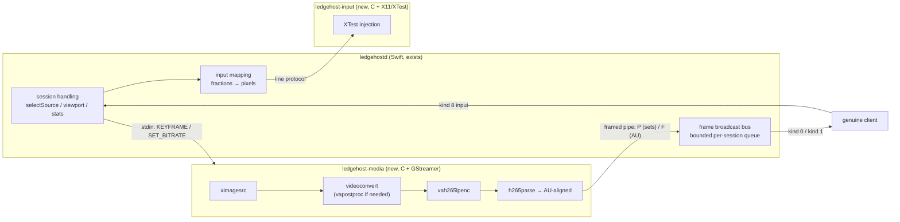

# Phase 1 plan — the minimal streaming slice (draft)

Status: DRAFT, written 2026-11-26 after Phase 0 completed.
Awaiting review. Nothing here is implemented yet.

Goal: from the genuine client, see the host's desktop moving and
operate it — capture → HEVC → wire → client decode, plus pointer,
scroll and keys back. One source (the desktop), one resolution
(the display's own), LAN only. Everything else (audio, windows as
separate sources, virtual displays, remote access, settings that
do something) is a later phase.

## What Phase 0 established

- The protocol core (identity, pairing, TLS gate, catalog) is
  accepted by the genuine client 0.6.2 on the target machine.
- The target's VA HEVC low-power encoder does 2266x1488 with
  ~90 fps headroom, zero reordering; a test encode plays on the
  iPad. ximagesrc moves full-resolution frames at negligible CPU;
  the 25 fps seen in 0-A was the measurement display's own cap.
- The client sends, per session: selectSource (kind 6), viewport
  (kind 9, with wanted fps), input (kind 8), clientStats
  (kind 12, 1 Hz), keyframeRequest (kind 44).

## The wire contract for media (from the upstream sources)

- kind 0 parameterSets: `ParameterSets.encoded()` — nalLen(1),
  count(1), then per set length(2, BE) + bytes. nalLen is 4.
  Sent before the frames it describes, and again whenever the
  sets change. Marked isKeyframe in the header.
- kind 1 frame: one HEVC access unit, NALs length-prefixed
  (hvcC style, 4-byte lengths), parameter-set NALs NOT in the AU
  (they live in kind 0). Header carries the capture timestamp
  (seconds) and the isKeyframe flag.
- StreamSource is `.desktop` for this phase. When a session's
  selectSource changes, the host re-sends the WindowList
  (kind 2) with `active` updated.
- InputEvent positions are fractions of the video frame; the
  host maps them onto the source rectangle. Cases: pointer
  (move/leftDown/leftUp/rightDown/rightUp), scroll, text,
  scrollGesture, key (USB HID usage + down + modifiers).
- ClientStats (kind 12) reports the client's received fps,
  frameAgeMs (host encode timestamp → device receipt) and RTT —
  the phase's latency evidence, logged by the daemon at 1 Hz.

## Architecture

Decisions baked into this draft (review points, not conclusions):

1. Media is a separate C process, per the Phase −1 architecture
   (core in Swift, media out-of-process). The daemon spawns it,
   reads framed access units from its stdout, and controls it
   over stdin (KEYFRAME, SET_BITRATE, STOP). AU alignment is
   solved by h265parse inside the helper; the daemon never scans
   a raw byte stream. A gst-launch child was rejected: it cannot
   force a keyframe on demand.
2. The Annex B → wire conversion (strip VPS/SPS/PPS into kind 0,
   4-byte length-prefix the rest) lives in the daemon, unit-tested
   against captured encoder output.
3. One pipeline, broadcast to every session watching the desktop
   (upstream's model). A session that selects the desktop gets
   the cached parameter sets at once, then joins at the next
   keyframe; the daemon forces a keyframe on join.
4. Backpressure: per-session bounded queue. A session that falls
   behind drops access units until the next keyframe (a dropped
   AU corrupts the GOP anyway; the client's keyframeRequest and
   the 1 s GOP bound the damage). No session may block the bus.
5. The cursor stays OUT of the video (upstream's model: the
   client draws its own pointer). kind 14/26 (cursor shape and
   host pointer position) are NOT in this phase; the trade-off
   is that a pointer moved by someone at the host is invisible
   on the device. Flagged for review.
6. The daemon takes its X display from its environment
   (DISPLAY), like any X client. Developing against an accessible
   remote-desktop session display is fine; running inside the
   seat session (user service) is packaging, a later step. No
   display number is hardcoded anywhere.
7. Frame timestamps are the capture wall-clock (seconds, the
   same epoch the header already uses), stamped by the helper
   from the buffer PTS plus its start wall-clock.
8. Input injection maps HID usages to X keycodes with the
   evdev convention (keycode = usage + 8) for the main block,
   and types text by the temporary-remap trick for arbitrary
   Unicode. Scroll becomes XTest wheel buttons (4–7), with
   scrollGesture phases mapped to press/release of a virtual
   smooth-scroll where feasible — best effort in this phase.

## Milestones

- P1-M1 Converter + proof offline. The Annex B → wire converter
  with unit tests; the probe gains a "record" mode that saves a
  session's kind 0/1 payloads, reassembles them, and the result
  must decode cleanly in ffprobe with the expected frame count.
- P1-M2 Media helper + daemon integration. selectSource
  (.desktop) starts the pipeline; parameter sets and frames flow.
  Acceptance (real client): the desktop is visible and visibly
  moving (a clock's seconds, a window dragged at the host).
- P1-M3 Input helper. Pointer move/click, wheel scroll, keys and
  text reach the host desktop. Acceptance (real client): from
  the iPad, click a button and type into a text editor on the
  host, with the result visible in the stream.
- P1-M4 Join and recovery. keyframeRequest forces an IDR;
  reconnect mid-stream yields a picture within ~1 s; a 10-minute
  stream stays up; ClientStats logged (fps / frameAge / RTT).
- P1-M5 Settings that are already on the wire. The pipeline runs
  at the catalog's bitrate and the client's wanted fps (kind 9);
  changeSettings for bitrate/fps retunes the encoder live
  (property writes, no pipeline restart) and re-sends kind 16.

## Non-goals for this phase

Audio (kind 43), per-window sources, thumbnails, clipboard,
gestures (kind 28), cursor shape/pointer kinds (14/26), virtual
displays, resize of the host display to the panel, Remote Access,
multi-client differences (one pipeline is shared; per-client
fps takes the max, as upstream does).

## Risks and open questions

- videoconvert (BGRA → NV12) cost at 2266x1488/60 on the target's
  CPU; vapostproc is the fallback if it eats the frame budget.
  Measured in P1-M2, not assumed.
- The seat display's capture rate (0-A could only measure a
  25 Hz-capped remote display). If the seat session also caps
  low, the phase still proves the slice; fps tuning follows.
- Dropping AUs mid-GOP: how does the genuine client actually
  behave (freeze until IDR? artefacts? immediate
  keyframeRequest)? Observed in P1-M4 against the real client,
  not guessed.
- Text typing via key remapping races with the user's real
  keyboard layout; acceptable for a slice, revisited if it bites.
- The media helper is the first C in the project: build wiring
  (a Makefile invoked from the package build, or a standalone
  build script) must stay as boring as the rest of the repo.
